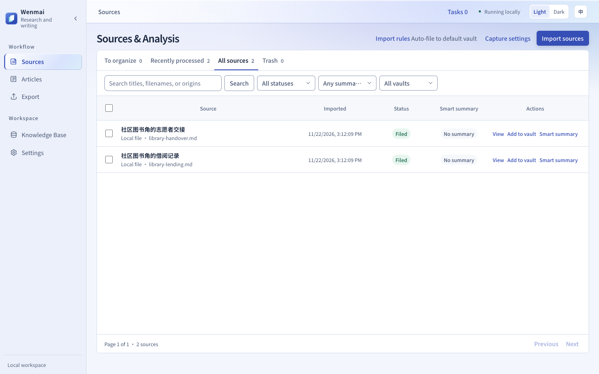
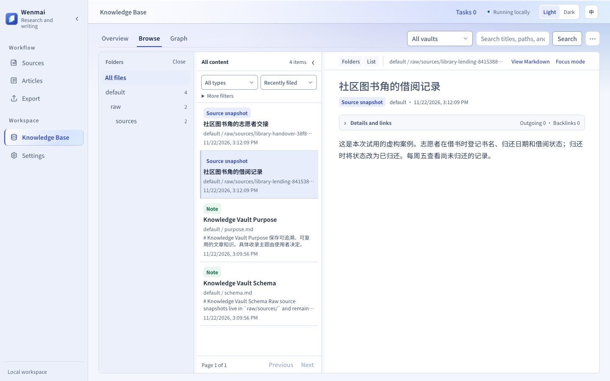
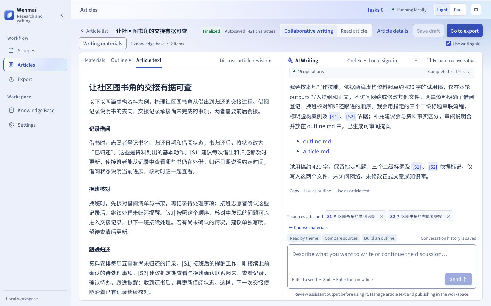
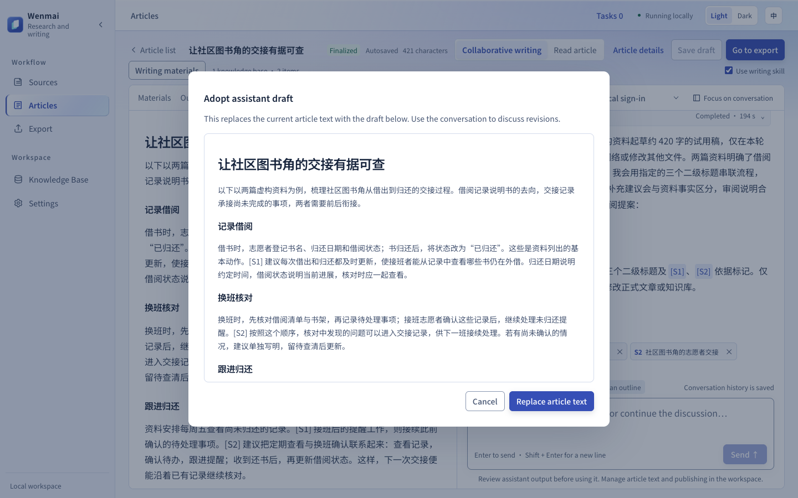
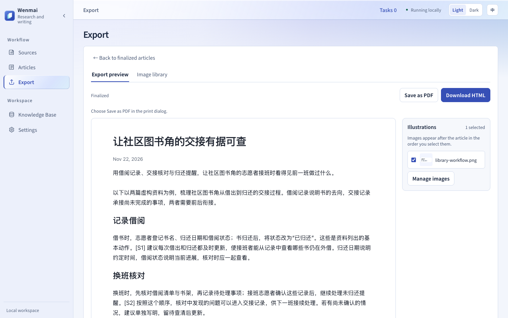

# Wenmai · Open Context Forge

[中文](README.md) | English

Wenmai is a local research and writing workspace. File your sources in a knowledge base, select one or more to work with, and draft an article with Codex or Claude. Review and finalize the article, then export it with illustrations as a PDF or an offline HTML file.

## Quick start

Use Node.js 22.12 or later. The repository’s `.nvmrc` pins the recommended version. Place `open-context-forge-vault-maintainer` and `open-context-forge-tech-article-writer` next to this repository, or point `OCF_MAINTAINER_ROOT` and `OCF_WRITER_ROOT` to their locations. Sign in to Codex or Claude CLI on your device before using AI Writing.

```bash
npm install
npm run dev
```

Open the [local Wenmai workspace](http://127.0.0.1:5173/). Under **Settings → Appearance → Language**, choose **English** or **中文**. You can also switch from the workspace header.

## From sources to an exported article

The screenshots show the English interface using the same fictional community library example as the Chinese guide.

### 1. Import and file your sources

Open **Sources** and choose **Import sources**. Drop in Markdown, HTML, plain text, or ZIP files. A new workspace files them automatically. When filing is complete, the items show **Filed** under **All sources**. With a manual import rule, file the items from **To organize**.



### 2. Check the source in the knowledge base

Open **Knowledge Base → Browse** and select an imported source. The reader shows the saved source text and its details. You can also connect an existing Obsidian folder from Settings.



### 3. Draft with one or more sources

Return to **Sources**, select your filed items, and click **Write article from selected sources**. The selected sources go into the article’s conversation. Choose an assistant profile and send your request from **AI Writing**. Open `outline.md` or `article.md` from the conversation to review it, or use the review action in the left pane. When the draft is ready, choose **Replace article text**.





### 4. Finalize and export

Check the title and article text, then choose **Finalize → Go to export**. To add an illustration, upload a PNG, JPEG, or WebP in **Image library** and select it in **Export preview**. **Download HTML** saves a file you can open offline. **Save as PDF** opens the browser’s print dialog, where you can save the document as a PDF.



## Local files and optional features

- The built-in knowledge base lives under `~/Library/Application Support/Open Context Forge/vaults/default` on macOS. Set `OCF_DATA_DIR` to use a separate data directory.
- Smart summaries use the local Claude CLI and `open-context-article-reader`. Set `OCF_READER_ROOT` if that tool is in a different directory.
- The walkthrough used vault-maintainer commit `052cdde`. If your sibling checkout uses session-based filing locks and imports keep waiting, set `OCF_MAINTAINER_ROOT` to a separate checkout of the walkthrough version.
- For development checks, run `npm test`, `npm run typecheck`, `npm run build`, and `npm run test:e2e`. The browser tests use an installed Chrome and temporary workspace data.
