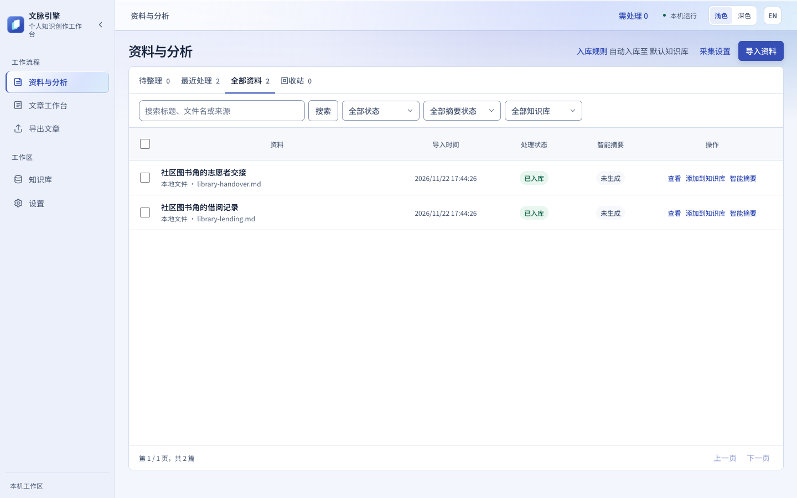
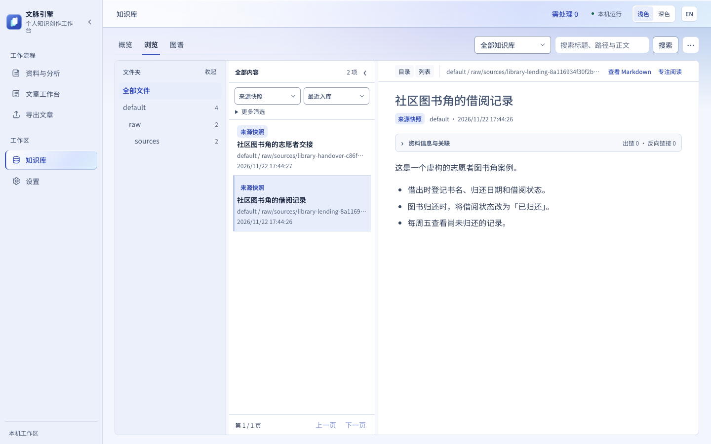
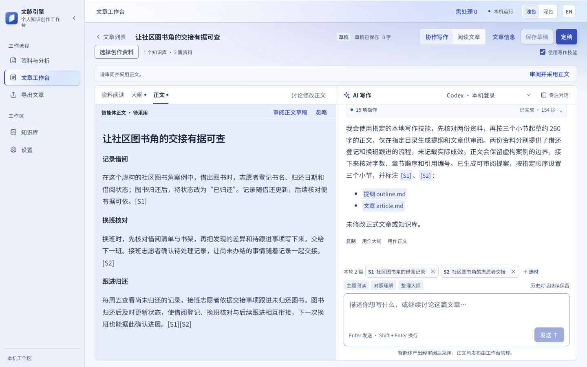
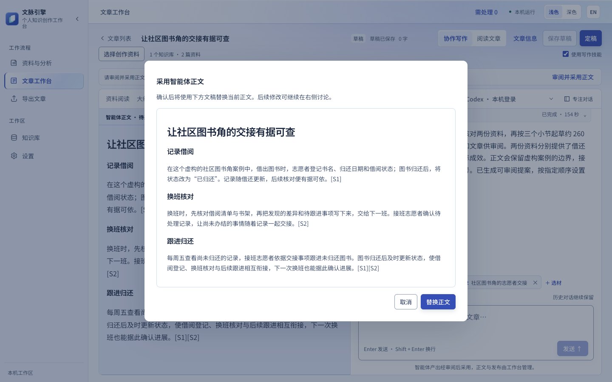
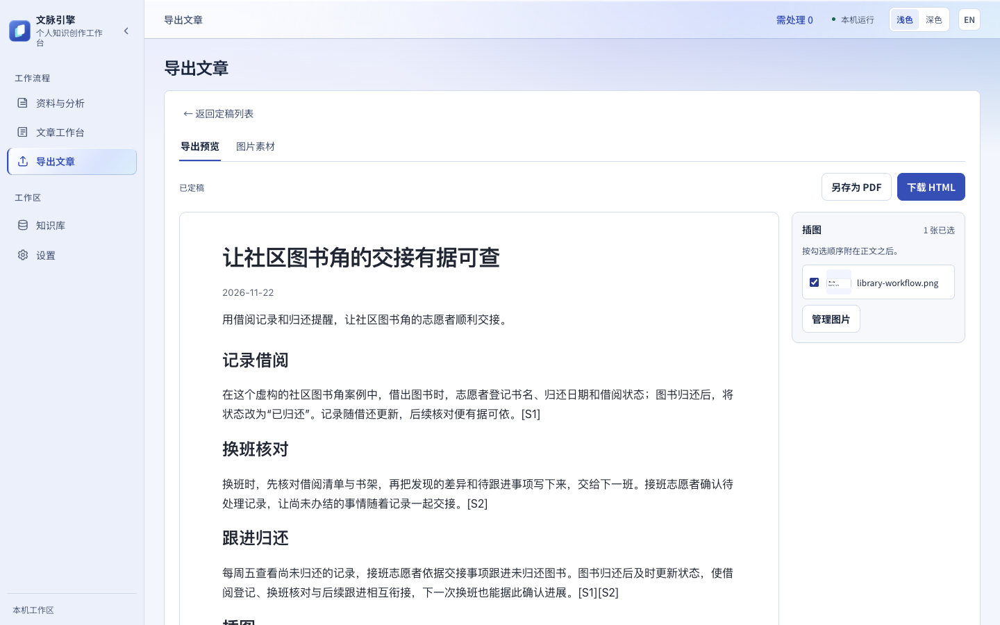

# 文脉引擎 · Open Context Forge

简体中文 | [English](README.md)

文脉引擎是一个在本机运行的知识创作工作台。把收集的资料存入知识库，选取一篇或多篇资料，与本机 Codex 或 Claude 讨论和写作。审阅并定稿后，可将文章连同插图导出为 PDF 或离线 HTML。

## 快速开始

使用 Node.js 22.12 或更高版本。仓库的 `.nvmrc` 指定了推荐版本。把 `open-context-forge-vault-maintainer` 和 `open-context-forge-tech-article-writer` 放在本仓库的同级目录，或通过 `OCF_MAINTAINER_ROOT` 和 `OCF_WRITER_ROOT` 指定路径。使用 AI 写作前，先在本机登录 Codex 或 Claude CLI。

```bash
npm install
npm run dev
```

打开 [文脉引擎本地工作台](http://127.0.0.1:5173/)。在「设置 → 外观 → 界面语言」切换中文和英语，也可使用页头的 **EN／中** 快捷切换。

## 从资料到成稿

以下截图使用试用工作区中的虚构示例「社区图书角」。可以下载[借阅记录](docs/examples/walkthrough/zh-CN/library-lending.md)和[志愿者交接](docs/examples/walkthrough/zh-CN/library-handover.md)，跟着步骤试用。

### 1. 导入资料并确认入库

进入「资料与分析」，点击「导入资料」。可拖入 Markdown、HTML、纯文本或 ZIP。新工作区默认自动入库。入库完成后，资料在「全部资料」里显示为「已入库」。采用手动规则时，从「待整理」选择资料并入库。



### 2. 在知识库里核对原文

从侧栏打开「知识库」，进入「浏览」。在列表中选择刚入库的资料，可核对快照正文和来源信息。知识库也可以连接本机已有的 Obsidian 文件夹。



### 3. 选材写作并审阅草稿

回到「资料与分析」，勾选一篇或多篇已入库资料，点击「用所选资料写文章」。选中的资料会带入这篇文章的对话。选择本机智能体，在右侧输入要求并发送。生成结果出现后，可点对话中的 `outline.md` 或 `article.md` 打开审阅，也可从左侧进入。核对正文后选择「替换正文」。





### 4. 定稿并导出

核对标题和正文，点击「定稿 → 前往导出」。可在「图片素材」上传现成的 PNG、JPEG 或 WebP，再回到「导出预览」勾选插图。点击「下载 HTML」可得到能离线打开的文件。点击「另存为 PDF」会打开浏览器的打印对话框，在其中选择「另存为 PDF」。



<details>
<summary>详细功能与开发说明</summary>

## 本地环境与导入规则

智能摘要使用 `open-context-article-reader`。可将其放在本仓库同级目录，或通过 `OCF_READER_ROOT` 指定目录。

试用验证使用 vault-maintainer 的提交 `052cdde`。如果同级目录正在开发会话级入库锁，可通过 `OCF_MAINTAINER_ROOT` 指向该提交的独立副本，避免连续导入时互相等待入库锁。

使用 nvm 时先运行 `nvm use`，并确保安装依赖与启动服务使用同一个 Node.js 版本。`better-sqlite3` 是原生模块；切换 Node.js 版本后若出现 `NODE_MODULE_VERSION` 错误，在目标版本下运行 `npm rebuild better-sqlite3`。


服务默认只监听 `127.0.0.1:3081`。首次启动会在 `~/Library/Application Support/Open Context Forge/vaults/default` 初始化内置默认 vault；设置 `OCF_DATA_DIR` 可更改应用数据目录。新安装默认自动入库至内置 vault，已有安装保留原先规则。资料处理台的“入库规则”或知识库设置可改为先放待整理，指定自动入库目标和默认原文归属。本批归属及单篇归属可覆盖规则；本地 Markdown frontmatter、HTML 元信息和正文附近署名只用于提取作者，不据此推断文章是否本人原创。点击“导入资料”可在弹窗中拖拽或选择多个 Markdown、HTML、TXT、ZIP 文件；普通 ZIP 会识别其中的多篇文本，Clipper ZIP 继续按 `captures.json` 校验。单个文本及 ZIP 展开的文本总量上限为 8 MiB，ZIP 文件上限为 20 MiB、最多导入 200 篇。未识别的 ZIP 文件会跳过并显示数量。本地文件保留文件名，不伪造网页 URL。浏览器一键采集插件尚未接入。添加普通 Obsidian 目录时，界面会先展示将新增的 OCF 文件，再等待明确确认。

接收资料后，服务先保存候选项，再将 raw 写入任务放入 SQLite 队列；入库接口返回 HTTP 202 和任务 ID，表示已排队，只有任务完成且快照哈希核验通过才显示“已入库”。raw 入库与知识维护各用独立执行通道，因此 Claude 长时间分析时仍能继续接收和写入后续资料。知识维护在启用的 vault 中逐篇串行执行，读取、计划、写入各阶段显示任务状态；可证明未写入的 raw 临时失败和知识维护读取失败按 1 分钟、10 分钟延迟重试。写入状态不明、CLI 无法启动或需要人工判断时会进入跨页面“需处理”，次日重新打开仍会提示；这个入口可检查写入日志、重新分析或明确选择保留原文。来源信息可在资料行修正；已入库资料使用 vault-maintainer 的锁和原值核对修改 manifest，raw 文件保持不变，已有知识结果会标记为需要检查同步，人工核对笔记后可执行校验完成。

“待整理”显示跨批次的全部未入库资料；“最近处理”显示最近 7 天已入库或已搁置资料；“全部资料”保留完整导入记录。时间窗口只影响显示，不自动删除。支持按标题、文件名或来源 URL 搜索、筛选、分页、当前页或全部筛选结果的选择、批量入库／分析／搁置／移入回收站。自动入库时，资料留在“全部资料”中，导入结果会显示正在入库、已入库和需检查的数量。点击“查看已入库资料”可打开最近入库的资料。勾选一篇或多篇已入库资料，点击“用所选资料写文章”，即可在新稿中继续。回收站可恢复或永久删除未入库的资料记录。

## 知识库工作区

侧栏“知识库”是只读的浏览工作区。概览同时显示各库刚入库的来源、最近修改的原有 Markdown 笔记、内容数量与读取异常；选中单库后还能查看 vault profile 指定的人工索引文件。浏览页按库、目录、类型、分析状态筛选，搜索标题、路径和正文，并查看 Markdown、智能摘要、出链和反向链接。图谱只绘制可解析的 wikilink、相对 Markdown 链接和来源引用；无法解析或存在歧义的链接列在下方，不会生成推测关系。

浏览正文时，文件开头的标准 YAML frontmatter 会整理为默认折叠的“笔记属性”；格式异常仍保留原始属性并继续显示正文。`[[笔记]]`、`[[笔记|别名]]`、`[[笔记#标题|别名]]` 以及相对 Markdown 链接可打开索引中已验证的目标；缺失或重名目标显示提示，代码示例保持原样。桌面端“专注阅读”临时收起目录和列表；“查看 Markdown”可切换完整原文，均不修改文件。

浏览递归扫描整个 vault，覆盖原有 `10-raw` 与 `20-wiki`，不再只显示入库清单或 wiki 路径。目录数字为包含子目录的文档文件数，支持 Markdown（含 `.markdown`／`.mdown`）、MDX、TXT、HTML 和 PDF；同名的 MD 与 MDX 按两个实际文件计数，PNG 等图片不计数。目录树自动隐藏文档数为 0 的目录（含空目录和只有图片的目录）；隐藏目录、符号链接及 `_legacy-*` 迁移备份不进入正式浏览与统计。MDX 只渲染 Markdown，不执行 JSX／脚本；HTML 转为只读 Markdown。PDF 支持内嵌预览和新窗口打开，目前只按标题／路径检索，未提取 PDF 正文，也不会作为文本带入写作。超过 2 MiB 的文本仍计数并列出，可下载原文件查看；其余支持的文本格式可用于创作选材。

浏览页按实际可用宽度安排目录、列表与正文，较窄的桌面窗口自动将目录改为抽屉。两条分隔线可拖动调宽，双击恢复自动宽度，也支持方向键调整；手动宽度与收起状态保存在当前浏览器，缩小窗口时会临时约束宽度以保留正文空间。正文工具栏的“目录”“列表”可恢复已收起的栏。

“设置 → 知识库连接”用于连接已有 Obsidian 目录、设置默认入库目标、重新索引、按库开启“入库后自动维护”和断开外部库。自动维护默认关闭；开启后，新入库资料会进入 SQLite 持久队列，由一个 Claude CLI 执行通道依次调用 `open-context-forge-vault-maintainer` 的分析与编译规则。结论为 `compile_now` 且来源证据、目标路径、文件哈希及 Skill 检查全部通过时，直接写入知识笔记；其他结论只保存智能摘要与计划。已有来源可在资料详情手动补编译，失败任务可重试。写入中断会标记为需要检查，服务不会推送 Git。

连接普通目录前会显示新增 OCF 文件的预览；断开仅移除平台登记与可重建索引，原目录文件不删除。未开启自动维护时，网页只浏览笔记；开启后仅按可校验的计划写回所选库。可复制路径或从详情跳到 Obsidian 编辑。外部修改由文件监听防抖后重建索引，页面停留期间约每 10 秒在后台检查更新；浏览列表不清空，保留当前页码、选中笔记与阅读位置，无变化时复用已有结果，更新失败时保留内容并自动重试。首次加载或切换知识库、筛选、页码时显示加载状态。若文件监听失效，再次读取也会触发刷新，还可点“重新索引”。SQLite 中的搜索与关系数据可从 Markdown 和来源 manifest 重建。

## 导出文章

在文章工作台定稿后点击“前往导出”，也可从侧栏“导出文章”选择定稿。导出内容包含标题、文章日期、摘要和正文。可选插图按勾选顺序附在正文后；不选图片也可导出。

- “下载 HTML”会保存一个可离线打开的文件，内嵌选中的插图和正文引用的本地图片。正文中的网络图片保留为原图链接。
- “另存为 PDF”会打开浏览器打印窗口，在目标打印机处选择“另存为 PDF”。打印版只包含文章与所选图片。

在“图片素材”可上传 PNG、JPEG、WebP，或用已有的图像服务制作图片。制作图片需要配置对应服务的 API Key；生成前可核对并修改画面提示词。Key 保存在应用数据目录的 `secrets/image-generation.json`。上传现成图片和导出文件无需图像服务。

## AI 辅助与写作对话

界面采用浅色精密工作台风格：浅灰导航、白色主体、深灰正文，蓝色集中用于主操作、链接和选中态。共享色板与外观规则集中在 `apps/web/src/appearance.css`，既有 CSS 保持布局和响应式职责。文章区域左侧为资料／文稿，右侧为 AI 对话；固定导航、顶栏、分页和专注模式保持独立。

界面和工作台正文使用 Adobe 发布的[思源黑体简体中文可变字体 2.005R](https://github.com/adobe-fonts/source-han-sans/tree/2.005R/Variable/WOFF2/TTF/Subset)。前端本地分发官方 WOFF2 文件，随附[原版权声明和 SIL OFL 1.1 许可证](apps/web/public/fonts/OFL-SourceHanSans.txt)。

文章工作台可先创建空稿，在右侧与智能体讨论大纲和正文；定稿需要标题和正文。日期留空时使用当天日期，摘要可选。独立文章列表支持搜索、状态筛选、导出、移入回收站及恢复。每篇文章按智能体方案保存独立会话；协作写作中可专注对话或与文稿并排，阅读模式以文章为主。左侧大纲和正文只读展示，智能体结果经审阅采用后写入正式版本。资料与分析页通过智能摘要使用 AI，知识库、设置、导出文章页不显示对话。

创作资料使用抽屉选择多个知识库，支持来源／笔记筛选、搜索、分页和正文预览；勾选与预览独立，“带入对话”仅准备资料，不自动调用智能体。新稿不继承上一次全局来源；已有单来源文章会迁入本文的独立资料清单。主工作区左侧可切换资料阅读（单篇／双篇对照）、大纲及正文，右侧为 AI 写作；“选择创作资料”与左侧阅读区对齐。每轮可移除附件、引用指定行或恢复本文全部资料；这些选择按文章保存在当前浏览器会话中，移除附件不会清除原生智能体的既有记忆。

发送时服务固定本轮全文快照、SHA256、库／相对路径／原文链接和选段行号，并为资料分配稳定的 S 编号；消息中的附件或 `[S1]` 引用可打开当轮快照，后续原文变化或本文移除资料不改写历史依据。单篇最多选用 30 篇资料、20 个库，单个来源上限 2 MiB，一轮完整资料总计不超过 12 MiB；超限明确报错，不静默截断为全文。大纲独立保存与确认，采用新大纲或更换创作资料后需重新核对；“按大纲起草正文”仅填入右侧对话的可编辑提问，仍需用户发送。旧版未保存大纲草稿可在左侧查看和补存，不能继续直接编辑。

“使用写作技能”在本机 writer `SKILL.md` 可读取时可选；默认使用相邻的 `open-context-forge-tech-article-writer`，也可用 `OCF_WRITER_ROOT` 指定技能目录。服务传入原始技能路径与根目录供原生 CLI 按需读取相对参考文档和脚本，不改全局技能配置，也不把请求当作已执行。每轮参考清单位于 `agent-workspaces/<articleId>/inputs/<turnId>/manifest.json`；智能体只被要求在 `outputs/<turnId>/outline.md`、`article.md` 写候选产物。进程退出后，平台提供有大小和路径校验的预览，明确采用后才进入正式大纲或正文；现阶段通过原生工具权限与提示约束文件操作，不提供独立的系统级文件沙箱。

文章回收站提供逐篇“永久删除”和“批量永久删除”，只处理确认选中的文章；“清空回收站”处理整个回收站，不受列表搜索和分页影响。确认后永久删除对应文章的正文、版本、工作台对话、执行记录与本地发布包。知识库来源、博客发布工作区和外部已发布内容保留；发布工作区的路径、提交和关联 ID 会单独归档，不直接删除 Git 工作树。若文章已被其他窗口恢复、修订发生变化或任务进程尚未退出，则整次操作拒绝执行并要求重新检查。文件清理保存在可重试队列中，服务重启会继续处理未完成的本地文件清理。

文章对话复用 `@agentclientprotocol/sdk` 与现成的 `claude-agent-acp`、`codex-acp` 适配器，不实现智能体规划或工具循环。Fastify 启动本机运行器，通过 ACP 接收文本与工具事件，再经 SSE 推送到浏览器。服务从 `PATH` 和常见安装位置发现 Claude、Codex，可通过 `OCF_CLAUDE_PATH`、`OCF_CODEX_PATH` 指定绝对路径。适配器明确使用检测到的本机 CLI，复用其当前登录；浏览器不会收到登录凭据。DeepSeek 和单独 API Key 仍经 Claude 运行器执行。

新任务立即返回，文本逐步显示，过程可展开查看工具状态与结果。原生运行器请求操作确认时，页面展示其提供的选项；点击“停止生成”会取消 ACP 会话并回收本轮进程。切换文章或刷新仅断开页面订阅，任务继续；返回时恢复保存的消息、部分输出、工具过程及待确认项。每篇文章同一时间只运行一项写作任务；不同方案保留各自的原生会话。未完成回复可复制，但不会直接作为完整文章采纳。

执行状态、事件和部分输出保存在本机 SQLite。服务意外重启后，未结束的任务标记中断，保留输出并允许重新发送，不自动重复可能有副作用的操作。任务最长运行 10 分钟；正常退出服务会停止正在运行的任务。每篇文章在数据目录的 `agent-workspaces/<articleId>` 下有独立参考快照，正式文章仍由修订 API 保存。控制台 `[agent-run]` 打印接受、确认、完成、失败与停止，以及耗时和输出字符数，不打印文章正文或密钥。

文章对话的 Claude 适配器只通过本轮 settings 关闭 hooks，以隔离 iTerm2 的 `cc-status`，保留 Skill、插件和工具能力；不会改写用户全局配置。具体可用能力仍由本机运行器与账号决定。来源分析及旧版同步接口继续使用原有 `claude -p --safe-mode`；`article-reader` 规则由服务显式读取。WorkBuddy 需要官方开放平台应用及 OAuth 授权，本轮尚未接入，不能作为已可用的本机 CLI 选择。

资料在入库前后均可点击“生成智能摘要”。点击后本机服务立即接收后台任务，单篇与批量任务排队执行；切换页面不会中断任务，页面会显示排队、分析中、完成或失败状态。任务记录保存在 SQLite，服务重启后会重新执行未完成的任务；回到资料页会恢复视图和展开的资料，并读取已完成的摘要。服务使用 `open-context-article-reader` 的阅读规则和本机 Claude CLI 分析资料，逐条校验模型给出的行号证据；结果先保存在本地数据库，资料入库是独立操作。旧版已确认的摘要在入库时会同步到目标 vault 的 `.ocf/compilations/<fingerprint>/analysis.md`；当前页面没有单独的摘要确认入口。当前单次分析限制来源快照不超过 40,000 字节；更长资料需要后续分段分析。已确认的摘要不会因再次点击分析而被覆盖。

可选方案在启动服务前通过环境变量配置：`OCF_DEEPSEEK_API_KEY` 启用 Claude CLI + DeepSeek，`OCF_ANTHROPIC_API_KEY` 启用单独的 Claude API Key。页面只显示方案状态，不显示密钥。当前已实测本机 Codex、Claude 登录方案的工具调用与会话续接；DeepSeek、独立 API Key 方案仍需在提供密钥后单独联调。DeepSeek Harness 不在本阶段范围内。

```bash
npm test
npm run typecheck
npm run build
npm run test:e2e
```

端到端测试使用本机安装的 Chrome、临时应用数据目录和临时外部 vault。

</details>
